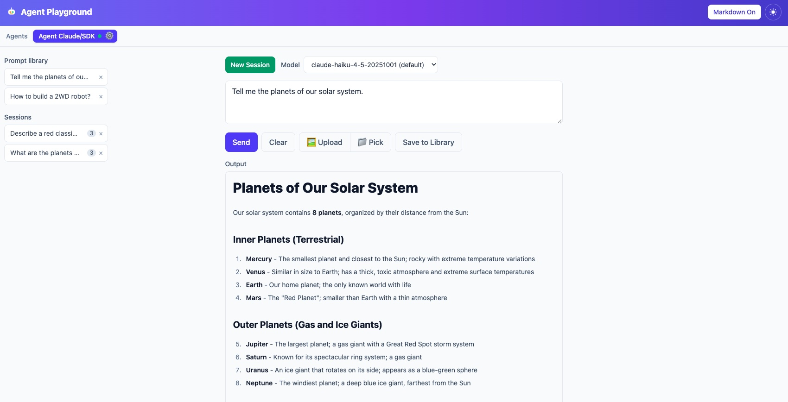
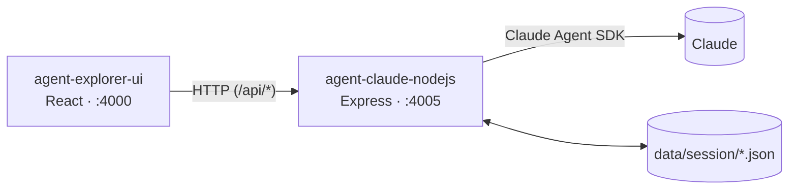
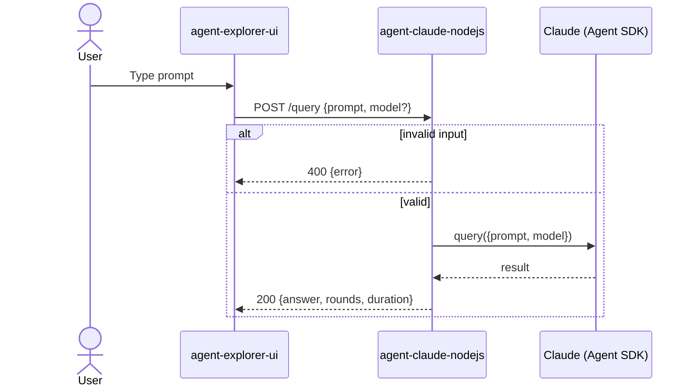
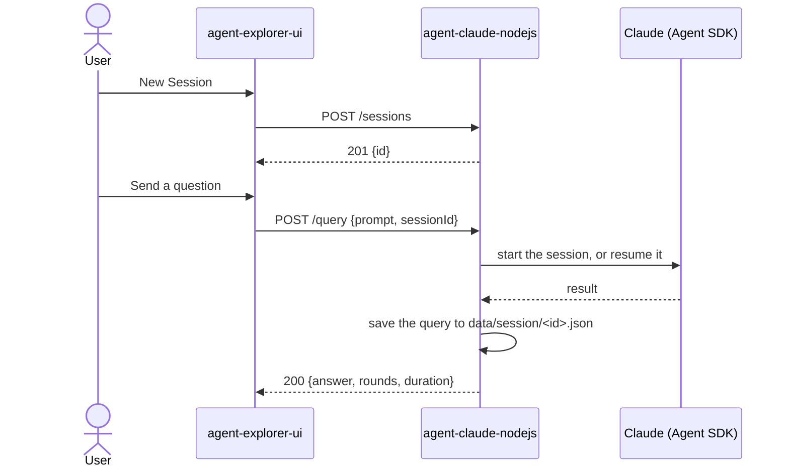

# Claude Agent Playground

This is a playground for agents built around Claude and the Claude Agent SDK. It's an easy way to learn and experiment, nothing more: an experimentation project where you can poke at agents, try ideas and see what happens. Expect rough edges, and expect things to change.



It has two parts: a Node.js backend that runs a Claude agent behind a REST API (built on the [Claude Agent SDK](https://docs.claude.com/en/api/agent-sdk/overview)), and a React UI to talk to it. Use it to try prompts, keep sessions, save prompts to a library and see how the agent answers.

| Project | What it is | Port |
|---|---|---|
| [agent-claude-nodejs](agent-claude-nodejs) | Express API that runs a Claude agent through the Claude Agent SDK | 4005 |
| [agent-explorer-ui](agent-explorer-ui) | React + Vite UI to send prompts and view answers | 4000 |

## Architecture



### Request flow for `POST /query`



### Request flow inside a session



## Setup

### Prerequisites

- Node.js **22.6 or newer** (the backend runs TypeScript natively, no build step)
- npm
- One way to authenticate with Claude, either:
  - an Anthropic API key, or
  - a Claude subscription, by signing in to [Claude Code](https://docs.claude.com/en/docs/claude-code/overview) (`claude`, then `/login`)

### 1. Backend

```bash
cd agent-claude-nodejs
npm install
cp .env.example .env
```

Edit `.env`:

| Variable | Required | Description |
|---|---|---|
| `PORT` | no | Port to listen on. Default `4005`. |
| `ANTHROPIC_API_KEY` | no | API key. If empty, the Claude Code login (subscription) is used instead. |
| `ANTHROPIC_BASE_URL` | no | Override the API base URL (e.g. a proxy or gateway). |
| `ALLOWED_MODELS` | no | Comma-separated allow-list for the `model` request param. Empty allows any model. |
| `SESSIONS_DIR` | no | Where sessions are saved as JSON. Default `data/session`, relative to where the server is started. |
| `LOG_LEVEL` | no | Log level. Default `info`. |

Start it:

```bash
npm run dev     # watch mode
# or
npm start
```

On startup the server loads the saved sessions and logs how it will authenticate, the allowed models, session stats (count, empty sessions, total queries, last activity) and the available endpoints, grouped by section.

### 2. UI

```bash
cd agent-explorer-ui
npm install
cp .env.example .env
npm run dev
```

Open <http://localhost:4000>.

- **Backend URL:** set in [agents.yml](agent-explorer-ui/agents.yml) (`baseUrl`). In dev, the Vite proxy forwards `/api/*` there, so leave `VITE_API_BASE_URL` empty.
- **Model dropdown:** `VITE_ALLOWED_MODELS` controls it. Keep it in sync with the backend's `ALLOWED_MODELS`.

#### Using the UI

- **Standalone queries:** with no session active, type a prompt and send it. Each send is independent.
- **Sessions:** click **New Session** to start one. The prompt box moves to the bottom of the screen and the conversation shows as a chat: your questions on the right, the agent's answers on the left. Every send in the session keeps the earlier context.
- **Session list:** once a session exists, a list appears in the left margin (below 1280px wide it appears above the chat). Each row shows the session name (the first line of its first prompt) and its number of queries. Click a row to open it, or click the open one again to leave it. The **×** deletes the session.
- **Close session ✕:** leaves session mode without deleting. The session id is shown above the button.

## API endpoints

Base URL: `http://localhost:4005`

### `GET /health`

Liveness check.

```bash
curl http://localhost:4005/health
```

```json
{ "status": "Ok", "service": "agent-claude-nodejs", "timestamp": "2026-10-20T06:44:31.000Z" }
```

### `POST /query`

Runs the agent against a prompt.

| Field | In | Type | Required | Description |
|---|---|---|---|---|
| `prompt` | body (JSON) | string | yes | The question or instruction for the agent. Must be non-empty. |
| `model` | body (JSON) | string | no | Overrides the default model. Must be in `ALLOWED_MODELS` if that is set. |
| `sessionId` | body (JSON) | string | no | Runs the prompt inside this session (see below). Unknown ids return `404`. |

```bash
curl -X POST http://localhost:4005/query \
  -H "Content-Type: application/json" \
  -d '{"prompt": "What is the capital of France?", "model": "claude-sonnet-5"}'
```

```json
{ "answer": "Paris is the capital of France.", "rounds": 1, "duration": 1840 }
```

| Field | Description |
|---|---|
| `answer` | The agent's final text reply. |
| `rounds` | Number of agent turns taken. |
| `duration` | Run time in milliseconds. |

Errors:

| Status | When |
|---|---|
| `400` | `prompt` is missing or empty, `model` or `sessionId` is not a string, or `model` is not in `ALLOWED_MODELS`. |
| `404` | `sessionId` does not match a known session. |
| `500` | The agent run failed. The body has `error` and `details`. |

### Sessions

Sessions let the agent keep the conversation context across `/query` calls. They are kept in memory and saved as JSON, one `<id>.json` file per session, in `data/session` (change it with `SESSIONS_DIR`). Saved sessions are loaded again when the server starts. The first query in a session creates it in the Claude Agent SDK, and later queries resume it. A session's `model` is used for its queries unless the request sets its own.

Notes:

- The first line of a session's first prompt becomes its `name`.
- `data/` is git-ignored, since it holds saved conversations.
- To resume a session after a restart, Claude Code must still have its own session files, which it keeps per working directory. Start the server from the same folder as before. Deleting a session removes only our JSON file, not Claude Code's.

| Endpoint | Description |
|---|---|
| `POST /sessions` | Create a session. Optional body: `{ "model": "claude-sonnet-5" }`. Returns `201` with the session. |
| `GET /sessions` | List sessions: `{ "sessions": [...] }`. |
| `GET /sessions/:id` | Session metadata, or `404`. |
| `DELETE /sessions/:id` | Forget the session. Returns `204`, or `404`. |

```bash
SESSION=$(curl -s -X POST http://localhost:4005/sessions | jq -r .id)

curl -X POST http://localhost:4005/query -H "Content-Type: application/json" \
  -d "{\"prompt\": \"My name is Ana.\", \"sessionId\": \"$SESSION\"}"
curl -X POST http://localhost:4005/query -H "Content-Type: application/json" \
  -d "{\"prompt\": \"What is my name?\", \"sessionId\": \"$SESSION\"}"
```

```json
{
  "id": "5b0c…",
  "name": "My name is Ana.",
  "model": "claude-sonnet-5",
  "createdAt": "2026-10-20T06:44:31.000Z",
  "updatedAt": "2026-10-20T06:45:02.000Z",
  "queryCount": 2,
  "queries": [
    { "prompt": "My name is Ana.", "answer": "Nice to meet you, Ana!", "createdAt": "2026-10-20T06:44:40.000Z" },
    { "prompt": "What is my name?", "answer": "Your name is Ana.", "createdAt": "2026-10-20T06:45:02.000Z" }
  ]
}
```

## Development

Backend (`agent-claude-nodejs`):

```bash
npm run typecheck   # tsc --noEmit
npm test            # vitest
```

UI (`agent-explorer-ui`):

```bash
npm run lint        # oxlint
npm run build       # production build
```
